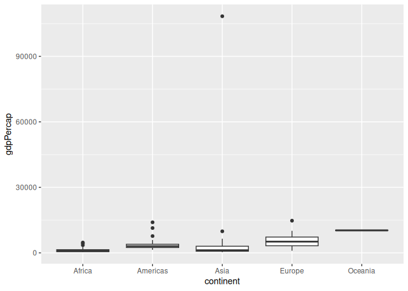
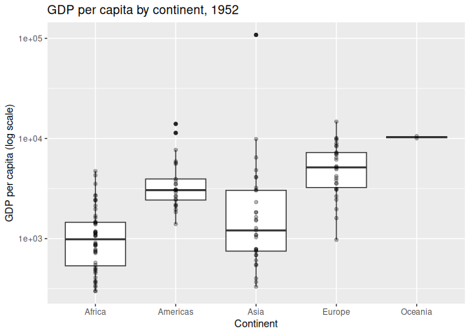
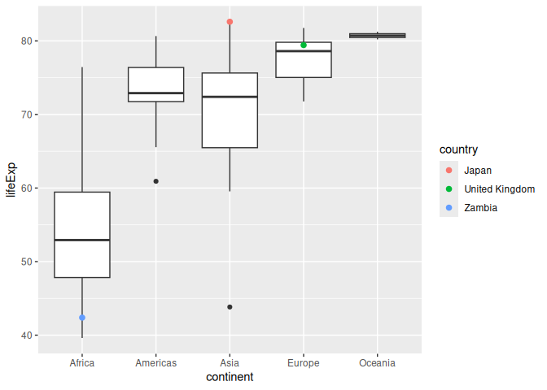
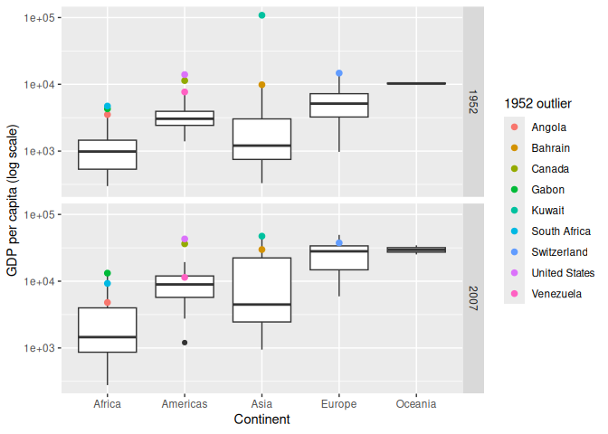
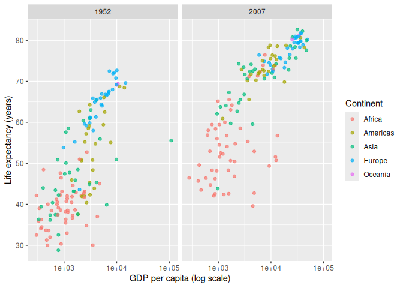
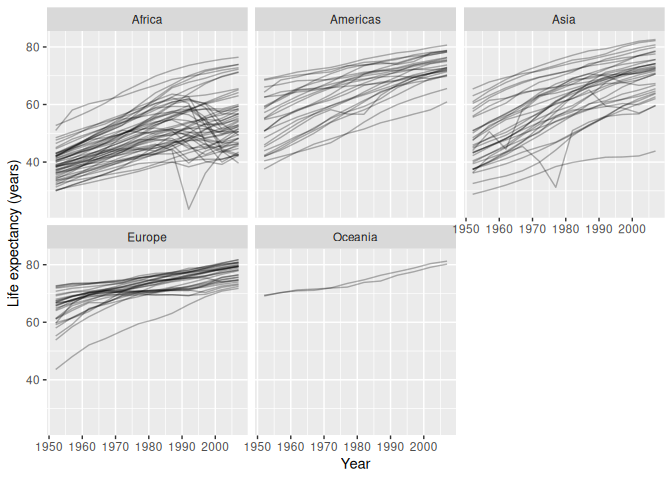
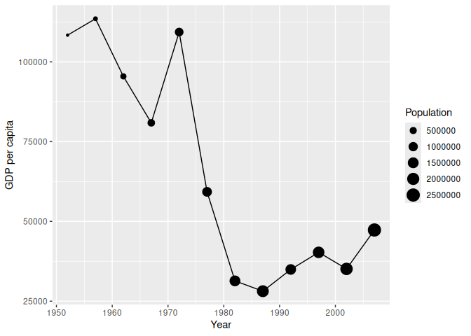

Gapminder
================
Dhvan Shah
2020-

- [Grading Rubric](#grading-rubric)
  - [Individual](#individual)
  - [Submission](#submission)
- [Guided EDA](#guided-eda)
  - [**q0** Perform your “first checks” on the dataset. What variables
    are in
    this](#q0-perform-your-first-checks-on-the-dataset-what-variables-are-in-this)
  - [**q1** Determine the most and least recent years in the `gapminder`
    dataset.](#q1-determine-the-most-and-least-recent-years-in-the-gapminder-dataset)
  - [**q2** Filter on years matching `year_min`, and make a plot of the
    GDP per capita against continent. Choose an appropriate `geom_` to
    visualize the data. What observations can you
    make?](#q2-filter-on-years-matching-year_min-and-make-a-plot-of-the-gdp-per-capita-against-continent-choose-an-appropriate-geom_-to-visualize-the-data-what-observations-can-you-make)
  - [**q3** You should have found *at least* three outliers in q2 (but
    possibly many more!). Identify those outliers (figure out which
    countries they
    are).](#q3-you-should-have-found-at-least-three-outliers-in-q2-but-possibly-many-more-identify-those-outliers-figure-out-which-countries-they-are)
  - [**q4** Create a plot similar to yours from q2 studying both
    `year_min` and `year_max`. Find a way to highlight the outliers from
    q3 on your plot *in a way that lets you identify which country is
    which*. Compare the patterns between `year_min` and
    `year_max`.](#q4-create-a-plot-similar-to-yours-from-q2-studying-both-year_min-and-year_max-find-a-way-to-highlight-the-outliers-from-q3-on-your-plot-in-a-way-that-lets-you-identify-which-country-is-which-compare-the-patterns-between-year_min-and-year_max)
- [Your Own EDA](#your-own-eda)
  - [**q5** Create *at least* three new figures below. With each figure,
    try to pose new questions about the
    data.](#q5-create-at-least-three-new-figures-below-with-each-figure-try-to-pose-new-questions-about-the-data)

*Purpose*: Learning to do EDA well takes practice! In this challenge
you’ll further practice EDA by first completing a guided exploration,
then by conducting your own investigation. This challenge will also give
you a chance to use the wide variety of visual tools we’ve been
learning.

<!-- include-rubric -->

# Grading Rubric

<!-- -------------------------------------------------- -->

Unlike exercises, **challenges will be graded**. The following rubrics
define how you will be graded, both on an individual and team basis.

## Individual

<!-- ------------------------- -->

| Category | Needs Improvement | Satisfactory |
|----|----|----|
| Effort | Some task **q**’s left unattempted | All task **q**’s attempted |
| Observed | Did not document observations, or observations incorrect | Documented correct observations based on analysis |
| Supported | Some observations not clearly supported by analysis | All observations clearly supported by analysis (table, graph, etc.) |
| Assessed | Observations include claims not supported by the data, or reflect a level of certainty not warranted by the data | Observations are appropriately qualified by the quality & relevance of the data and (in)conclusiveness of the support |
| Specified | Uses the phrase “more data are necessary” without clarification | Any statement that “more data are necessary” specifies which *specific* data are needed to answer what *specific* question |
| Code Styled | Violations of the [style guide](https://style.tidyverse.org/) hinder readability | Code sufficiently close to the [style guide](https://style.tidyverse.org/) |

## Submission

<!-- ------------------------- -->

Make sure to commit both the challenge report (`report.md` file) and
supporting files (`report_files/` folder) when you are done! Then submit
a link to Canvas. **Your Challenge submission is not complete without
all files uploaded to GitHub.**

``` r
library(tidyverse)
```

    ## ── Attaching core tidyverse packages ──────────────────────── tidyverse 2.0.0 ──
    ## ✔ dplyr     1.2.1     ✔ readr     2.2.0
    ## ✔ forcats   1.0.1     ✔ stringr   1.6.0
    ## ✔ ggplot2   4.0.3     ✔ tibble    3.3.1
    ## ✔ lubridate 1.9.5     ✔ tidyr     1.3.2
    ## ✔ purrr     1.2.2     
    ## ── Conflicts ────────────────────────────────────────── tidyverse_conflicts() ──
    ## ✖ dplyr::filter() masks stats::filter()
    ## ✖ dplyr::lag()    masks stats::lag()
    ## ℹ Use the conflicted package (<http://conflicted.r-lib.org/>) to force all conflicts to become errors

``` r
library(gapminder)
```

*Background*: [Gapminder](https://www.gapminder.org/about-gapminder/) is
an independent organization that seeks to educate people about the state
of the world. They seek to counteract the worldview constructed by a
hype-driven media cycle, and promote a “fact-based worldview” by
focusing on data. The dataset we’ll study in this challenge is from
Gapminder.

# Guided EDA

<!-- -------------------------------------------------- -->

First, we’ll go through a round of *guided EDA*. Try to pay attention to
the high-level process we’re going through—after this guided round
you’ll be responsible for doing another cycle of EDA on your own!

### **q0** Perform your “first checks” on the dataset. What variables are in this

dataset?

``` r
## TASK: Do your "first checks" here!
gapminder |> glimpse()
```

    ## Rows: 1,704
    ## Columns: 6
    ## $ country   <fct> "Afghanistan", "Afghanistan", "Afghanistan", "Afghanistan", …
    ## $ continent <fct> Asia, Asia, Asia, Asia, Asia, Asia, Asia, Asia, Asia, Asia, …
    ## $ year      <int> 1952, 1957, 1962, 1967, 1972, 1977, 1982, 1987, 1992, 1997, …
    ## $ lifeExp   <dbl> 28.801, 30.332, 31.997, 34.020, 36.088, 38.438, 39.854, 40.8…
    ## $ pop       <int> 8425333, 9240934, 10267083, 11537966, 13079460, 14880372, 12…
    ## $ gdpPercap <dbl> 779.4453, 820.8530, 853.1007, 836.1971, 739.9811, 786.1134, …

``` r
gapminder |> summary()
```

    ##         country        continent        year         lifeExp     
    ##  Afghanistan:  12   Africa  :624   Min.   :1952   Min.   :23.60  
    ##  Albania    :  12   Americas:300   1st Qu.:1966   1st Qu.:48.20  
    ##  Algeria    :  12   Asia    :396   Median :1980   Median :60.71  
    ##  Angola     :  12   Europe  :360   Mean   :1980   Mean   :59.47  
    ##  Argentina  :  12   Oceania : 24   3rd Qu.:1993   3rd Qu.:70.85  
    ##  Australia  :  12                  Max.   :2007   Max.   :82.60  
    ##  (Other)    :1632                                                
    ##       pop              gdpPercap       
    ##  Min.   :6.001e+04   Min.   :   241.2  
    ##  1st Qu.:2.794e+06   1st Qu.:  1202.1  
    ##  Median :7.024e+06   Median :  3531.8  
    ##  Mean   :2.960e+07   Mean   :  7215.3  
    ##  3rd Qu.:1.959e+07   3rd Qu.:  9325.5  
    ##  Max.   :1.319e+09   Max.   :113523.1  
    ## 

**Observations**:

- The variables are country, continent, year, lifeExp, pop and
  gdpPercap.
- country and continent are factors, year and pop are integers, lifeExp
  and gdpPercap are doubles.
- 1704 rows. The summary doesn’t show any NAs in any column so I think
  the data is complete.
- lifeExp is life expectancy in years, it goes from about 23 to 83.
- gdpPercap is GDP per person. The summary says the min is about 240 and
  the max is about 113500, but the median is only about 3500. So the max
  is like 30 times the median. There are definitely outliers in here.

### **q1** Determine the most and least recent years in the `gapminder` dataset.

*Hint*: Use the `pull()` function to get a vector out of a tibble.
(Rather than the `$` notation of base R.)

``` r
## TASK: Find the largest and smallest values of `year` in `gapminder`
year_max <-
  gapminder |>
  pull(year) |>
  max()

year_min <-
  gapminder |>
  pull(year) |>
  min()

year_max
```

    ## [1] 2007

``` r
year_min
```

    ## [1] 1952

Use the following test to check your work.

``` r
## NOTE: No need to change this
assertthat::assert_that(year_max %% 7 == 5)
```

    ## [1] TRUE

``` r
assertthat::assert_that(year_max %% 3 == 0)
```

    ## [1] TRUE

``` r
assertthat::assert_that(year_min %% 7 == 6)
```

    ## [1] TRUE

``` r
assertthat::assert_that(year_min %% 3 == 2)
```

    ## [1] TRUE

``` r
if (is_tibble(year_max)) {
  print("year_max is a tibble; try using `pull()` to get a vector")
  assertthat::assert_that(False)
}

print("Nice!")
```

    ## [1] "Nice!"

### **q2** Filter on years matching `year_min`, and make a plot of the GDP per capita against continent. Choose an appropriate `geom_` to visualize the data. What observations can you make?

You may encounter difficulties in visualizing these data; if so document
your challenges and attempt to produce the most informative visual you
can.

``` r
## TASK: Create a visual of gdpPercap vs continent
gapminder |>
  filter(year == year_min) |>
  ggplot(aes(continent, gdpPercap)) +
  geom_boxplot()
```

<!-- -->

``` r
gapminder |>
  filter(year == year_min) |>
  ggplot(aes(continent, gdpPercap)) +
  geom_boxplot() +
  geom_point(alpha = 0.3) +
  scale_y_log10() +
  labs(
    x = "Continent",
    y = "GDP per capita (log scale)",
    title = "GDP per capita by continent, 1952"
  )
```

<!-- -->

**Observations**:

- Europe and Oceania are the richest in 1952. Oceania only has 2 dots on
  the whole plot so I don’t really trust its box.
- Africa is the poorest. Median around 1000 and most of it is under
  2000.
- Asia is the most spread out. It has stuff down near 300 and it also
  has the one giant outlier at the top.
- Every continent has its outliers on the high side, not the low side.
  So in each one there are a few countries way richer than normal, but
  nobody way poorer than normal.
- Africa and Asia overlap a lot. If you told me a country was at 1000 in
  1952 I couldn’t guess which of those two it was in.

**Difficulties & Approaches**:

- The first plot is useless. One country is up around 108000 and
  everything else is under 15000, so that one point stretches the axis
  and all five boxes squash into flat lines at the bottom. I can tell
  there’s an outlier and that’s about it.
- I put the y axis on a log scale instead. The boxes spread back out and
  I can still see the outlier, I didn’t have to throw it away. Downside
  is the axis is harder to read, the same distance on the plot means a
  different number of dollars depending on where you are.
- I also put the points on top so I can see how many countries are
  actually in each box. Oceania is only 2 dots, which you can’t tell
  from a boxplot by itself.

### **q3** You should have found *at least* three outliers in q2 (but possibly many more!). Identify those outliers (figure out which countries they are).

``` r
## TASK: Identify the outliers from q2
df_outliers <-
  gapminder |>
  filter(year == year_min) |>
  group_by(continent) |>
  filter(gdpPercap > quantile(gdpPercap, 0.75) + 1.5 * IQR(gdpPercap)) |>
  ungroup() |>
  arrange(desc(gdpPercap))

df_outliers |> select(country, continent, gdpPercap, pop)
```

    ## # A tibble: 9 × 4
    ##   country       continent gdpPercap       pop
    ##   <fct>         <fct>         <dbl>     <int>
    ## 1 Kuwait        Asia        108382.    160000
    ## 2 Switzerland   Europe       14734.   4815000
    ## 3 United States Americas     13990. 157553000
    ## 4 Canada        Americas     11367.  14785584
    ## 5 Bahrain       Asia          9867.    120447
    ## 6 Venezuela     Americas      7690.   5439568
    ## 7 South Africa  Africa        4725.  14264935
    ## 8 Gabon         Africa        4293.    420702
    ## 9 Angola        Africa        3521.   4232095

``` r
outlier_countries <- df_outliers |> pull(country)
```

**Observations**:

- Identify the outlier countries from q2
  - I used the same rule the boxplot uses for its dots, more than 1.5
    IQR above the upper quartile of its own continent. That gets me 9
    countries.
  - Asia: Kuwait (about 108000) and Bahrain (about 9900).
  - Americas: United States (about 14000), Canada (about 11000),
    Venezuela (about 7700).
  - Europe: Switzerland (about 15000).
  - Africa: South Africa (about 4700), Gabon (about 4300), Angola (about
    3500).
  - Kuwait is way out there. It’s about 7 times the next one on this
    list. I don’t know what’s going on but the pop column is
    interesting, Kuwait has 160000 people and the US has 157 million. So
    it’s a tiny country. If a small number of people are splitting up
    whatever the country earns then per capita gets big fast, which
    might be all this is.
  - The African ones aren’t really rich, they’re just rich for Africa.
    South Africa at 4700 would be below the median in Europe. So whether
    something counts as an outlier depends on what group you put it in.

*Hint*: For the next task, it’s helpful to know a ggplot trick we’ll
learn in an upcoming exercise: You can use the `data` argument inside
any `geom_*` to modify the data that will be plotted *by that geom
only*. For instance, you can use this trick to filter a set of points to
label:

``` r
## NOTE: No need to edit, use ideas from this in q4 below
gapminder %>%
  filter(year == max(year)) %>%

  ggplot(aes(continent, lifeExp)) +
  geom_boxplot() +
  geom_point(
    data = . %>% filter(country %in% c("United Kingdom", "Japan", "Zambia")),
    mapping = aes(color = country),
    size = 2
  )
```

<!-- -->

### **q4** Create a plot similar to yours from q2 studying both `year_min` and `year_max`. Find a way to highlight the outliers from q3 on your plot *in a way that lets you identify which country is which*. Compare the patterns between `year_min` and `year_max`.

*Hint*: We’ve learned a lot of different ways to show multiple
variables; think about using different aesthetics or facets.

``` r
## TASK: Create a visual of gdpPercap vs continent
gapminder |>
  filter(year %in% c(year_min, year_max)) |>
  ggplot(aes(continent, gdpPercap)) +
  geom_boxplot() +
  geom_point(
    data = . %>% filter(country %in% outlier_countries),
    mapping = aes(color = country),
    size = 2
  ) +
  scale_y_log10() +
  facet_grid(year ~ .) +
  labs(
    x = "Continent",
    y = "GDP per capita (log scale)",
    color = "1952 outlier"
  )
```

<!-- -->

**Observations**:

- Every box moves up. So everyone got richer, it’s not one continent
  pulling ahead.
- Africa moved up the least. In 1952 its box overlapped Asia’s a bit. In
  2007 there’s clear space between the top of Africa’s box and the
  bottom of the Americas’ box, they don’t overlap at all anymore. And
  since this is a log axis, that space means a multiplier, not a fixed
  number of dollars, so the gap is bigger than it looks.
- Asia’s box got taller, not shorter. I thought it would shrink once
  Kuwait came down but it didn’t. In 2007 Asia’s middle half covers more
  ground than any other continent. So Asia is spreading apart, not
  converging.
- Kuwait drops a lot. In 1952 it’s alone way at the top and by 2007 it’s
  down near where Switzerland and the US are. It’s not even flagged as
  an Asian outlier anymore, the dot sits inside the whisker. I don’t
  think it actually got poorer, I think the population thing from q3 is
  doing it. Checking that in q5.
- Most of the 1952 outliers are still high in 2007, so being rich then
  was a decent predictor of being rich later. The US and Canada are
  still flagged in the Americas.
- But not all of them held. Switzerland is inside Europe’s box now,
  which would make sense if the rest of Europe caught up. Venezuela
  dropped the most, it’s not even near the top of the Americas anymore.
- Gabon and South Africa are still flagged in Africa. Angola isn’t.

# Your Own EDA

<!-- -------------------------------------------------- -->

Now it’s your turn! We just went through guided EDA considering the GDP
per capita at two time points. You can continue looking at outliers,
consider different years, repeat the exercise with `lifeExp`, consider
the relationship between variables, or something else entirely.

### **q5** Create *at least* three new figures below. With each figure, try to pose new questions about the data.

My question here is whether the relationship between money and life
expectancy changed over the 55 years in the dataset.

``` r
## TASK: Your first graph
gapminder |>
  filter(year %in% c(year_min, year_max)) |>
  ggplot(aes(gdpPercap, lifeExp, color = continent)) +
  geom_point(alpha = 0.7) +
  scale_x_log10() +
  facet_grid(. ~ year) +
  labs(
    x = "GDP per capita (log scale)",
    y = "Life expectancy (years)",
    color = "Continent"
  )
```

<!-- -->

- Richer countries live longer in both years. I used a log x axis
  because without it everything piles up on the left again like in q2.
- Even on the log axis it’s not a clean line. Down at the low end a
  small jump in money goes with a big jump in years, and up at the rich
  end the points go almost flat. Past maybe 10000 it doesn’t look like
  more money buys you much.
- 1952 is a lot messier than 2007. In 1952 I can find countries at
  around the same GDP that are 20 years apart on life expectancy. By
  2007 the points sit much closer to one trend.
- Everything shifts up and to the right between the panels, so countries
  got richer and lived longer.
- In 1952 Africa and Asia are mixed together in the bottom left. By 2007
  most of the Asia points have moved up with everyone else and Africa
  hasn’t.
- The thing I didn’t expect is the red points in 2007 sitting around 40
  to 50 years while other countries at that same GDP are up at 70. Those
  don’t follow the pattern everyone else does. I want to look at that
  next.

My question here is whether any country actually went backwards on life
expectancy, since the overall trend is so strongly upward.

``` r
## TASK: Your second graph
gapminder |>
  ggplot(aes(year, lifeExp, group = country)) +
  geom_line(alpha = 0.3) +
  facet_wrap(~ continent) +
  labs(
    x = "Year",
    y = "Life expectancy (years)"
  )
```

<!-- -->

- Almost every line goes up. That’s the main thing going on here.
- Africa is where it breaks. A bunch of those lines climb until around
  the late 80s, then turn around and come back down through the 90s. A
  few of them end up lower in 2007 than they were 30 years earlier. That
  explains the low red points in my last plot.
- Two drops are way sharper than the rest. One in Africa around 1992
  that falls something like 20 years in a single step, and one in Asia
  in the 70s that drops about 10. A gradual trend wouldn’t look like
  that, so something specific must have happened in those two countries.
  I can’t tell what from this data.
- Europe and Oceania are boring, which I guess is the good outcome.
  Lines go up and bunch together.
- Europe’s lines start pretty spread out and end up almost on top of
  each other. Africa does the opposite, it starts as the tightest panel
  and ends as the widest. I would have guessed every continent tightens
  up over time and that’s not what happened.
- One thing to be careful about: the data is every 5 years, so I’m
  drawing straight lines between points that are 5 years apart.
  Something could have dropped and recovered in between and I’d never
  see it.

My question here is why Kuwait stopped being an outlier, since q4 made
it look like it got dramatically poorer.

``` r
## TASK: Your third graph
gapminder |>
  filter(country == "Kuwait") |>
  ggplot(aes(year, gdpPercap)) +
  geom_line() +
  geom_point(aes(size = pop)) +
  labs(
    x = "Year",
    y = "GDP per capita",
    size = "Population"
  )
```

<!-- -->

- It really does drop. Peaks a little over 110000 in the 50s and bottoms
  out under 30000 in the late 80s, then comes partway back up.
- The dots get bigger the whole way down. Population starts at 160000
  and ends somewhere over 2 million.
- So the q3 guess holds up. Per capita is a division, and the bottom of
  it got a lot bigger over these years. That alone could pull the number
  down without the country earning any less.
- What I can’t do is actually check that, because the dataset doesn’t
  have total GDP in it, only the per capita version. To tell “Kuwait got
  poorer” apart from “Kuwait got more people” I’d need total GDP for
  each year, and that isn’t in here.
- There’s one spot around 1992 where the line dips and the dot gets
  smaller, so population went down for one step. It’s the only time that
  happens. No idea why from this data.
