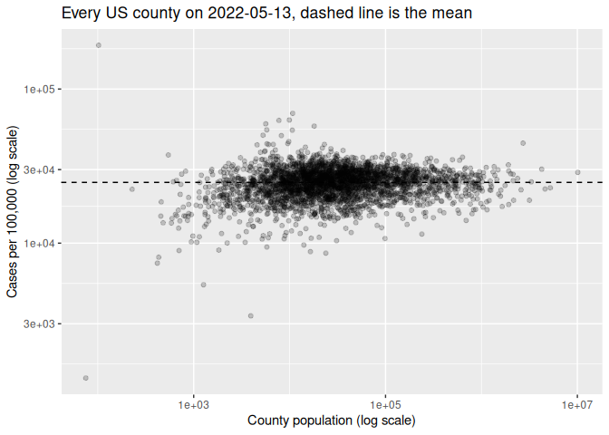
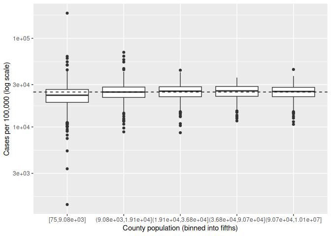
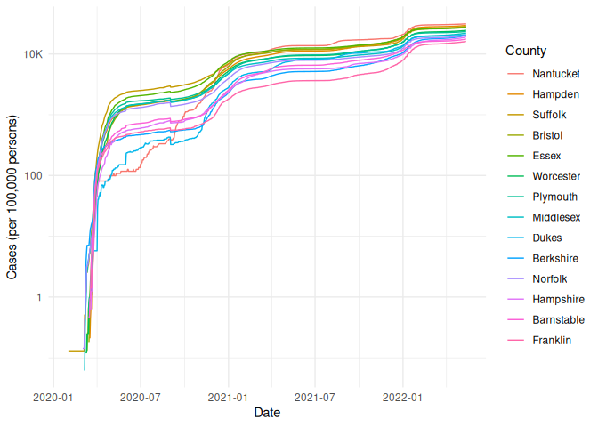

COVID-19
================
(Your name here)
2020-

- [Grading Rubric](#grading-rubric)
  - [Individual](#individual)
  - [Submission](#submission)
- [The Big Picture](#the-big-picture)
- [Get the Data](#get-the-data)
  - [Navigating the Census Bureau](#navigating-the-census-bureau)
    - [**q1** Load Table `B01003` into the following tibble. Make sure
      the column names are
      `id, Geographic Area Name, Estimate!!Total, Margin of Error!!Total`.](#q1-load-table-b01003-into-the-following-tibble-make-sure-the-column-names-are-id-geographic-area-name-estimatetotal-margin-of-errortotal)
  - [Automated Download of NYT Data](#automated-download-of-nyt-data)
    - [**q2** Visit the NYT GitHub repo and find the URL for the **raw**
      US County-level data. Assign that URL as a string to the variable
      below.](#q2-visit-the-nyt-github-repo-and-find-the-url-for-the-raw-us-county-level-data-assign-that-url-as-a-string-to-the-variable-below)
- [Join the Data](#join-the-data)
  - [**q3** Process the `id` column of `df_pop` to create a `fips`
    column.](#q3-process-the-id-column-of-df_pop-to-create-a-fips-column)
  - [**q4** Join `df_covid` with `df_q3` by the `fips` column. Use the
    proper type of join to preserve *only* the rows in
    `df_covid`.](#q4-join-df_covid-with-df_q3-by-the-fips-column-use-the-proper-type-of-join-to-preserve-only-the-rows-in-df_covid)
- [Analyze](#analyze)
  - [Normalize](#normalize)
    - [**q5** Use the `population` estimates in `df_data` to normalize
      `cases` and `deaths` to produce per 100,000 counts \[3\]. Store
      these values in the columns `cases_per100k` and
      `deaths_per100k`.](#q5-use-the-population-estimates-in-df_data-to-normalize-cases-and-deaths-to-produce-per-100000-counts-3-store-these-values-in-the-columns-cases_per100k-and-deaths_per100k)
  - [Guided EDA](#guided-eda)
    - [**q6** Compute some summaries](#q6-compute-some-summaries)
    - [**q7** Find and compare the top
      10](#q7-find-and-compare-the-top-10)
  - [Self-directed EDA](#self-directed-eda)
    - [**q8** Drive your own ship: You’ve just put together a very rich
      dataset; you now get to explore! Pick your own direction and
      generate at least one punchline figure to document an interesting
      finding. I give a couple tips & ideas
      below:](#q8-drive-your-own-ship-youve-just-put-together-a-very-rich-dataset-you-now-get-to-explore-pick-your-own-direction-and-generate-at-least-one-punchline-figure-to-document-an-interesting-finding-i-give-a-couple-tips--ideas-below)
    - [Ideas](#ideas)
    - [Aside: Some visualization
      tricks](#aside-some-visualization-tricks)
    - [Geographic exceptions](#geographic-exceptions)
- [Notes](#notes)

*Purpose*: In this challenge, you’ll learn how to navigate the U.S.
Census Bureau website, programmatically download data from the internet,
and perform a county-level population-weighted analysis of current
COVID-19 trends. This will give you the base for a very deep
investigation of COVID-19, which we’ll build upon for Project 1.

<!-- include-rubric -->

# Grading Rubric

<!-- -------------------------------------------------- -->

Unlike exercises, **challenges will be graded**. The following rubrics
define how you will be graded, both on an individual and team basis.

## Individual

<!-- ------------------------- -->

| Category | Needs Improvement | Satisfactory |
|----|----|----|
| Effort | Some task **q**’s left unattempted | All task **q**’s attempted |
| Observed | Did not document observations, or observations incorrect | Documented correct observations based on analysis |
| Supported | Some observations not clearly supported by analysis | All observations clearly supported by analysis (table, graph, etc.) |
| Assessed | Observations include claims not supported by the data, or reflect a level of certainty not warranted by the data | Observations are appropriately qualified by the quality & relevance of the data and (in)conclusiveness of the support |
| Specified | Uses the phrase “more data are necessary” without clarification | Any statement that “more data are necessary” specifies which *specific* data are needed to answer what *specific* question |
| Code Styled | Violations of the [style guide](https://style.tidyverse.org/) hinder readability | Code sufficiently close to the [style guide](https://style.tidyverse.org/) |

## Submission

<!-- ------------------------- -->

Make sure to commit both the challenge report (`report.md` file) and
supporting files (`report_files/` folder) when you are done! Then submit
a link to Canvas. **Your Challenge submission is not complete without
all files uploaded to GitHub.**

``` r
library(tidyverse)
```

    ## ── Attaching core tidyverse packages ──────────────────────── tidyverse 2.0.0 ──
    ## ✔ dplyr     1.2.1     ✔ readr     2.2.0
    ## ✔ forcats   1.0.1     ✔ stringr   1.6.0
    ## ✔ ggplot2   4.0.3     ✔ tibble    3.3.1
    ## ✔ lubridate 1.9.5     ✔ tidyr     1.3.2
    ## ✔ purrr     1.2.2     
    ## ── Conflicts ────────────────────────────────────────── tidyverse_conflicts() ──
    ## ✖ dplyr::filter() masks stats::filter()
    ## ✖ dplyr::lag()    masks stats::lag()
    ## ℹ Use the conflicted package (<http://conflicted.r-lib.org/>) to force all conflicts to become errors

*Background*:
[COVID-19](https://en.wikipedia.org/wiki/Coronavirus_disease_2019) is
the disease caused by the virus SARS-CoV-2. In 2020 it became a global
pandemic, leading to huge loss of life and tremendous disruption to
society. The New York Times (as of writing) publishes up-to-date data on
the progression of the pandemic across the United States—we will study
these data in this challenge.

*Optional Readings*: I’ve found this [ProPublica
piece](https://www.propublica.org/article/how-to-understand-covid-19-numbers)
on “How to understand COVID-19 numbers” to be very informative!

# The Big Picture

<!-- -------------------------------------------------- -->

We’re about to go through *a lot* of weird steps, so let’s first fix the
big picture firmly in mind:

We want to study COVID-19 in terms of data: both case counts (number of
infections) and deaths. We’re going to do a county-level analysis in
order to get a high-resolution view of the pandemic. Since US counties
can vary widely in terms of their population, we’ll need population
estimates in order to compute infection rates (think back to the
`Titanic` challenge).

That’s the high-level view; now let’s dig into the details.

# Get the Data

<!-- -------------------------------------------------- -->

1.  County-level population estimates (Census Bureau)
2.  County-level COVID-19 counts (New York Times)

## Navigating the Census Bureau

<!-- ------------------------- -->

**Steps**: Our objective is to find the 2018 American Community
Survey\[1\] (ACS) Total Population estimates, disaggregated by counties.
To check your results, this is Table `B01003`.

1.  Go to [data.census.gov](data.census.gov).
2.  Scroll down and click `View Tables`.
3.  Apply filters to find the ACS **Total Population** estimates,
    disaggregated by counties. I used the filters:

- `Topics > Populations and People > Counts, Estimates, and Projections > Population Total`
- `Geography > County > All counties in United States`

5.  Select the **Total Population** table and click the `Download`
    button to download the data; make sure to select the 2018 5-year
    estimates.
6.  Unzip and move the data to your `challenges/data` folder.

- Note that the data will have a crazy-long filename like
  `ACSDT5Y2018.B01003_data_with_overlays_2020-07-26T094857.csv`. That’s
  because metadata is stored in the filename, such as the year of the
  estimate (`Y2018`) and my access date (`2020-07-26`). **Your filename
  will vary based on when you download the data**, so make sure to copy
  the filename that corresponds to what you downloaded!

### **q1** Load Table `B01003` into the following tibble. Make sure the column names are `id, Geographic Area Name, Estimate!!Total, Margin of Error!!Total`.

*Hint*: You will need to use the `skip` keyword when loading these data!

``` r
## TASK: Load the census bureau data with the following tibble name.
df_pop <- read_csv(
  "data/ACSDT5Y2018.B01003-Data.csv", 
  skip = 1, 
  col_select = -`...5`
  ) |> 
  rename(
    id = Geography
  ) |> 
  ## According to the website for this data a Margin of error of ***** means the data has exact population counts
  mutate(
   `Margin of Error!!Total` = ifelse(`Margin of Error!!Total` == "*****", "0", `Margin of Error!!Total`) 
  )
```

    ## New names:
    ## Rows: 3220 Columns: 4
    ## ── Column specification
    ## ──────────────────────────────────────────────────────── Delimiter: "," chr
    ## (3): Geography, Geographic Area Name, Margin of Error!!Total dbl (1):
    ## Estimate!!Total
    ## ℹ Use `spec()` to retrieve the full column specification for this data. ℹ
    ## Specify the column types or set `show_col_types = FALSE` to quiet this message.
    ## • `` -> `...5`

``` r
df_pop
```

    ## # A tibble: 3,220 × 4
    ##    id            `Geographic Area Name` `Estimate!!Total` Margin of Error!!Tot…¹
    ##    <chr>         <chr>                              <dbl> <chr>                 
    ##  1 0500000US010… Autauga County, Alaba…             55200 0                     
    ##  2 0500000US010… Baldwin County, Alaba…            208107 0                     
    ##  3 0500000US010… Barbour County, Alaba…             25782 0                     
    ##  4 0500000US010… Bibb County, Alabama               22527 0                     
    ##  5 0500000US010… Blount County, Alabama             57645 0                     
    ##  6 0500000US010… Bullock County, Alaba…             10352 0                     
    ##  7 0500000US010… Butler County, Alabama             20025 0                     
    ##  8 0500000US010… Calhoun County, Alaba…            115098 0                     
    ##  9 0500000US010… Chambers County, Alab…             33826 0                     
    ## 10 0500000US010… Cherokee County, Alab…             25853 0                     
    ## # ℹ 3,210 more rows
    ## # ℹ abbreviated name: ¹​`Margin of Error!!Total`

*Note*: You can find information on 1-year, 3-year, and 5-year estimates
[here](https://www.census.gov/programs-surveys/acs/guidance/estimates.html).
The punchline is that 5-year estimates are more reliable but less
current.

## Automated Download of NYT Data

<!-- ------------------------- -->

ACS 5-year estimates don’t change all that often, but the COVID-19 data
are changing rapidly. To that end, it would be nice to be able to
*programmatically* download the most recent data for analysis; that way
we can update our analysis whenever we want simply by re-running our
notebook. This next problem will have you set up such a pipeline.

The New York Times is publishing up-to-date data on COVID-19 on
[GitHub](https://github.com/nytimes/covid-19-data).

### **q2** Visit the NYT [GitHub](https://github.com/nytimes/covid-19-data) repo and find the URL for the **raw** US County-level data. Assign that URL as a string to the variable below.

``` r
## TASK: Find the URL for the NYT covid-19 county-level data
url_counties <- "https://raw.githubusercontent.com/nytimes/covid-19-data/master/us-counties.csv"
```

Once you have the url, the following code will download a local copy of
the data, then load the data into R.

``` r
## NOTE: No need to change this; just execute
## Set the filename of the data to download
filename_nyt <- "./data/nyt_counties.csv"

## Download the data locally
curl::curl_download(
        url_counties,
        destfile = filename_nyt
      )

## Loads the downloaded csv
df_covid <- read_csv(filename_nyt)
```

    ## Rows: 2502832 Columns: 6
    ## ── Column specification ────────────────────────────────────────────────────────
    ## Delimiter: ","
    ## chr  (3): county, state, fips
    ## dbl  (2): cases, deaths
    ## date (1): date
    ## 
    ## ℹ Use `spec()` to retrieve the full column specification for this data.
    ## ℹ Specify the column types or set `show_col_types = FALSE` to quiet this message.

You can now re-run the chunk above (or the entire notebook) to pull the
most recent version of the data. Thus you can periodically re-run this
notebook to check in on the pandemic as it evolves.

*Note*: You should feel free to copy-paste the code above for your own
future projects!

# Join the Data

<!-- -------------------------------------------------- -->

To get a sense of our task, let’s take a glimpse at our two data
sources.

``` r
## NOTE: No need to change this; just execute
df_pop %>% glimpse
```

    ## Rows: 3,220
    ## Columns: 4
    ## $ id                       <chr> "0500000US01001", "0500000US01003", "0500000U…
    ## $ `Geographic Area Name`   <chr> "Autauga County, Alabama", "Baldwin County, A…
    ## $ `Estimate!!Total`        <dbl> 55200, 208107, 25782, 22527, 57645, 10352, 20…
    ## $ `Margin of Error!!Total` <chr> "0", "0", "0", "0", "0", "0", "0", "0", "0", …

``` r
df_covid %>% glimpse
```

    ## Rows: 2,502,832
    ## Columns: 6
    ## $ date   <date> 2020-01-21, 2020-01-22, 2020-01-23, 2020-01-24, 2020-01-24, 20…
    ## $ county <chr> "Snohomish", "Snohomish", "Snohomish", "Cook", "Snohomish", "Or…
    ## $ state  <chr> "Washington", "Washington", "Washington", "Illinois", "Washingt…
    ## $ fips   <chr> "53061", "53061", "53061", "17031", "53061", "06059", "17031", …
    ## $ cases  <dbl> 1, 1, 1, 1, 1, 1, 1, 1, 1, 1, 1, 1, 1, 1, 1, 1, 1, 1, 1, 1, 1, …
    ## $ deaths <dbl> 0, 0, 0, 0, 0, 0, 0, 0, 0, 0, 0, 0, 0, 0, 0, 0, 0, 0, 0, 0, 0, …

To join these datasets, we’ll need to use [FIPS county
codes](https://en.wikipedia.org/wiki/FIPS_county_code).\[2\] The last
`5` digits of the `id` column in `df_pop` is the FIPS county code, while
the NYT data `df_covid` already contains the `fips`.

### **q3** Process the `id` column of `df_pop` to create a `fips` column.

``` r
## TASK: Create a `fips` column by extracting the county code
df_q3 <- df_pop |> 
  separate(
    col = id,
    into = c(NA, "fips"),
    sep = -5
  )

df_q3
```

    ## # A tibble: 3,220 × 4
    ##    fips  `Geographic Area Name`   `Estimate!!Total` `Margin of Error!!Total`
    ##    <chr> <chr>                                <dbl> <chr>                   
    ##  1 01001 Autauga County, Alabama              55200 0                       
    ##  2 01003 Baldwin County, Alabama             208107 0                       
    ##  3 01005 Barbour County, Alabama              25782 0                       
    ##  4 01007 Bibb County, Alabama                 22527 0                       
    ##  5 01009 Blount County, Alabama               57645 0                       
    ##  6 01011 Bullock County, Alabama              10352 0                       
    ##  7 01013 Butler County, Alabama               20025 0                       
    ##  8 01015 Calhoun County, Alabama             115098 0                       
    ##  9 01017 Chambers County, Alabama             33826 0                       
    ## 10 01019 Cherokee County, Alabama             25853 0                       
    ## # ℹ 3,210 more rows

Use the following test to check your answer.

``` r
## NOTE: No need to change this
## Check known county
assertthat::assert_that(
              (df_q3 %>%
              filter(str_detect(`Geographic Area Name`, "Autauga County")) %>%
              pull(fips)) == "01001"
            )
```

    ## [1] TRUE

``` r
print("Very good!")
```

    ## [1] "Very good!"

### **q4** Join `df_covid` with `df_q3` by the `fips` column. Use the proper type of join to preserve *only* the rows in `df_covid`.

``` r
## TASK: Join df_covid and df_q3 by fips.
df_q4 <- left_join(
  df_covid,
  df_q3,
  by = c('fips')
)
```

Use the following test to check your answer.

``` r
## NOTE: No need to change this
if (!any(df_q4 %>% pull(fips) %>% str_detect(., "02105"), na.rm = TRUE)) {
  assertthat::assert_that(TRUE)
} else {
  print(str_c(
    "Your df_q4 contains a row for the Hoonah-Angoon Census Area (AK),",
    "which is not in df_covid. You used the incorrect join type.",
    sep = " "
  ))
  assertthat::assert_that(FALSE)
}
```

    ## [1] TRUE

``` r
if (any(df_q4 %>% pull(fips) %>% str_detect(., "78010"), na.rm = TRUE)) {
  assertthat::assert_that(TRUE)
} else {
  print(str_c(
    "Your df_q4 does not include St. Croix, US Virgin Islands,",
    "which is in df_covid. You used the incorrect join type.",
    sep = " "
  ))
  assertthat::assert_that(FALSE)
}
```

    ## [1] TRUE

``` r
print("Very good!")
```

    ## [1] "Very good!"

For convenience, I down-select some columns and produce more convenient
column names.

``` r
## NOTE: No need to change; run this to produce a more convenient tibble
df_data <-
  df_q4 %>%
  select(
    date,
    county,
    state,
    fips,
    cases,
    deaths,
    population = `Estimate!!Total`
  )

df_data
```

    ## # A tibble: 2,502,832 × 7
    ##    date       county      state      fips  cases deaths population
    ##    <date>     <chr>       <chr>      <chr> <dbl>  <dbl>      <dbl>
    ##  1 2020-01-21 Snohomish   Washington 53061     1      0     786620
    ##  2 2020-01-22 Snohomish   Washington 53061     1      0     786620
    ##  3 2020-01-23 Snohomish   Washington 53061     1      0     786620
    ##  4 2020-01-24 Cook        Illinois   17031     1      0    5223719
    ##  5 2020-01-24 Snohomish   Washington 53061     1      0     786620
    ##  6 2020-01-25 Orange      California 06059     1      0    3164182
    ##  7 2020-01-25 Cook        Illinois   17031     1      0    5223719
    ##  8 2020-01-25 Snohomish   Washington 53061     1      0     786620
    ##  9 2020-01-26 Maricopa    Arizona    04013     1      0    4253913
    ## 10 2020-01-26 Los Angeles California 06037     1      0   10098052
    ## # ℹ 2,502,822 more rows

# Analyze

<!-- -------------------------------------------------- -->

Now that we’ve done the hard work of loading and wrangling the data, we
can finally start our analysis. Our first step will be to produce county
population-normalized cases and death counts. Then we will explore the
data.

## Normalize

<!-- ------------------------- -->

### **q5** Use the `population` estimates in `df_data` to normalize `cases` and `deaths` to produce per 100,000 counts \[3\]. Store these values in the columns `cases_per100k` and `deaths_per100k`.

``` r
## TASK: Normalize cases and deaths
df_normalized <-
  df_data |> 
  mutate(
    cases_per100k = (cases / population) * 100000,
    deaths_per100k = (deaths / population) * 100000
  )
```

You may use the following test to check your work.

``` r
## NOTE: No need to change this
## Check known county data
if (any(df_normalized %>% pull(date) %>% str_detect(., "2020-01-21"))) {
  assertthat::assert_that(TRUE)
} else {
  print(str_c(
    "Date 2020-01-21 not found; did you download the historical data (correct),",
    "or just the most recent data (incorrect)?",
    sep = " "
  ))
  assertthat::assert_that(FALSE)
}
```

    ## [1] TRUE

``` r
if (any(df_normalized %>% pull(date) %>% str_detect(., "2022-05-13"))) {
  assertthat::assert_that(TRUE)
} else {
  print(str_c(
    "Date 2022-05-13 not found; did you download the historical data (correct),",
    "or a single year's data (incorrect)?",
    sep = " "
  ))
  assertthat::assert_that(FALSE)
}
```

    ## [1] TRUE

``` r
## Check datatypes
assertthat::assert_that(is.numeric(df_normalized$cases))
```

    ## [1] TRUE

``` r
assertthat::assert_that(is.numeric(df_normalized$deaths))
```

    ## [1] TRUE

``` r
assertthat::assert_that(is.numeric(df_normalized$population))
```

    ## [1] TRUE

``` r
assertthat::assert_that(is.numeric(df_normalized$cases_per100k))
```

    ## [1] TRUE

``` r
assertthat::assert_that(is.numeric(df_normalized$deaths_per100k))
```

    ## [1] TRUE

``` r
## Check that normalization is correct
assertthat::assert_that(
              abs(df_normalized %>%
               filter(
                 str_detect(county, "Snohomish"),
                 date == "2020-01-21"
               ) %>%
              pull(cases_per100k) - 0.127) < 1e-3
            )
```

    ## [1] TRUE

``` r
assertthat::assert_that(
              abs(df_normalized %>%
               filter(
                 str_detect(county, "Snohomish"),
                 date == "2020-01-21"
               ) %>%
              pull(deaths_per100k) - 0) < 1e-3
            )
```

    ## [1] TRUE

``` r
print("Excellent!")
```

    ## [1] "Excellent!"

## Guided EDA

<!-- ------------------------- -->

Before turning you loose, let’s complete a couple guided EDA tasks.

### **q6** Compute some summaries

Compute the mean and standard deviation for `cases_per100k` and
`deaths_per100k`. *Make sure to carefully choose **which rows** to
include in your summaries,* and justify why!

``` r
## TASK: Compute mean and sd for cases_per100k and deaths_per100k

## What you get if you don't filter at all
df_normalized |>
  summarize(
    mean_cases = mean(cases_per100k, na.rm = TRUE),
    sd_cases = sd(cases_per100k, na.rm = TRUE),
    mean_deaths = mean(deaths_per100k, na.rm = TRUE),
    sd_deaths = sd(deaths_per100k, na.rm = TRUE)
  )
```

    ## # A tibble: 1 × 4
    ##   mean_cases sd_cases mean_deaths sd_deaths
    ##        <dbl>    <dbl>       <dbl>     <dbl>
    ## 1      9975.    8449.        174.      159.

``` r
## One row per county, at the most recent date
df_normalized |>
  filter(date == max(date)) |>
  summarize(
    n_counties = n(),
    mean_cases = mean(cases_per100k, na.rm = TRUE),
    sd_cases = sd(cases_per100k, na.rm = TRUE),
    mean_deaths = mean(deaths_per100k, na.rm = TRUE),
    sd_deaths = sd(deaths_per100k, na.rm = TRUE)
  )
```

    ## # A tibble: 1 × 5
    ##   n_counties mean_cases sd_cases mean_deaths sd_deaths
    ##        <int>      <dbl>    <dbl>       <dbl>     <dbl>
    ## 1       3258     24774.    6233.        375.      160.

- Which rows did you pick?
  - Only the rows on the last date in the data, 2022-05-13. That’s one
    row per county, 3258 of them.
- Why?
  - The cases and deaths columns are cumulative, not daily. Every county
    shows up on all 844 dates and its number only goes up. So a row
    isn’t an independent observation, it’s a running total, and
    averaging all 2.5 million rows together is averaging the same county
    with itself 844 times.
  - It also drags the number way down. The unfiltered mean is about 9975
    cases per 100k and the last-date mean is about 24775. The unfiltered
    one is lower because most of 2020 the counts were near zero, and all
    those early rows get averaged in. That number isn’t the case rate
    anywhere, it’s the average of the pandemic’s whole history, which
    isn’t a thing I’d want to report.
  - Taking the last date instead gives me “how much of each county had
    been infected by the end of the data”, which is a question that
    actually makes sense.
  - I used na.rm = TRUE because the New York City rows have no fips, so
    they got no population from the join and their per 100k values are
    NA. That’s about 28800 rows. Dropping them means the five boroughs
    aren’t in these numbers at all, so this is really a mean over
    counties that aren’t NYC.
  - One more thing worth saying: this is a mean over counties, not over
    people. Every county counts the same whether it has 102 people or 10
    million. If I wanted the rate for a typical American instead of a
    typical county that would be a different calculation.

### **q7** Find and compare the top 10

Find the top 10 counties in terms of `cases_per100k`, and the top 10 in
terms of `deaths_per100k`. Report the population of each county along
with the per-100,000 counts. Compare the counts against the mean values
you found in q6. Note any observations.

``` r
## TASK: Find the top 10 max cases_per100k counties; report populations as well
df_normalized |>
  filter(!is.na(cases_per100k)) |>
  group_by(fips, county, state) |>
  filter(cases_per100k == max(cases_per100k)) |>
  filter(date == min(date)) |>
  ungroup() |>
  arrange(desc(cases_per100k)) |>
  select(county, state, population, cases_per100k, date) |>
  head(10) |>
  knitr::kable()
```

| county                   | state        | population | cases_per100k | date       |
|:-------------------------|:-------------|-----------:|--------------:|:-----------|
| Loving                   | Texas        |        102 |     192156.86 | 2022-05-12 |
| Chattahoochee            | Georgia      |      10767 |      69527.26 | 2022-05-11 |
| Nome Census Area         | Alaska       |       9925 |      62921.91 | 2022-05-11 |
| Northwest Arctic Borough | Alaska       |       7734 |      62542.02 | 2022-05-11 |
| Crowley                  | Colorado     |       5630 |      59449.38 | 2022-05-13 |
| Bethel Census Area       | Alaska       |      18040 |      57439.02 | 2022-05-11 |
| Dewey                    | South Dakota |       5779 |      54317.36 | 2022-03-30 |
| Dimmit                   | Texas        |      10663 |      54018.57 | 2022-05-12 |
| Jim Hogg                 | Texas        |       5282 |      50132.53 | 2022-05-12 |
| Kusilvak Census Area     | Alaska       |       8198 |      49817.03 | 2022-05-11 |

``` r
## TASK: Find the top 10 deaths_per100k counties; report populations as well
df_normalized |>
  filter(!is.na(deaths_per100k)) |>
  group_by(fips, county, state) |>
  filter(deaths_per100k == max(deaths_per100k)) |>
  filter(date == min(date)) |>
  ungroup() |>
  arrange(desc(deaths_per100k)) |>
  select(county, state, population, deaths_per100k, date) |>
  head(10) |>
  knitr::kable()
```

| county            | state        | population | deaths_per100k | date       |
|:------------------|:-------------|-----------:|---------------:|:-----------|
| McMullen          | Texas        |        662 |      1359.5166 | 2022-02-19 |
| Galax city        | Virginia     |       6638 |      1175.0527 | 2022-04-27 |
| Motley            | Texas        |       1156 |      1124.5675 | 2022-03-10 |
| Hancock           | Georgia      |       8535 |      1054.4815 | 2022-04-20 |
| Emporia city      | Virginia     |       5381 |      1022.1148 | 2022-04-19 |
| Towns             | Georgia      |      11417 |      1016.0287 | 2022-04-27 |
| Jerauld           | South Dakota |       2029 |       985.7072 | 2022-02-14 |
| Loving            | Texas        |        102 |       980.3922 | 2022-03-04 |
| Robertson         | Kentucky     |       2143 |       979.9347 | 2022-02-03 |
| Martinsville city | Virginia     |      13101 |       946.4926 | 2022-05-05 |

**Observations**:

- Every single county on both lists is small. The biggest one on the
  cases list is Bethel Census Area at about 18000 people and the biggest
  on the deaths list is Martinsville city at about 13100. The median
  county in this data has around 25900 people, so the entire top 20 sits
  below the median.
- The numbers are way above the q6 means. Mean cases per 100k was about
  24775 and Loving County Texas is at 192157, which is about 8x. On
  deaths the mean was about 375 and McMullen County Texas is at 1360,
  about 4x.
- Loving County can’t be right. 192157 per 100k works out to 1.9 cases
  per person. With 102 people in the county that’s roughly 196 cases
  recorded against 102 residents. Either people are being counted more
  than once, or the census number is too low for how many people are
  actually there on a given day. I’d guess the second one, 102 is small
  enough that a handful of workers who don’t live there permanently
  would throw it off.
- That’s the general problem with this whole list. At these populations
  one outbreak moves the rate enormously. McMullen County’s 1360 deaths
  per 100k is 9 deaths in a county of 662. Nine deaths is a bad month at
  a single nursing home, and it lands the county at number one in the
  country.
- So I don’t read these as the ten worst hit places. I read them as the
  ten places where the denominator was small enough for normal variation
  to look extreme.
- Alaska shows up four times in the cases top 10 (Nome, Northwest
  Arctic, Bethel, Kusilvak). Texas shows up three times on each list. I
  don’t know whether that’s a real regional thing or just that those two
  states have a lot of very small counties.
- When did these “largest values” occur?
  - Mostly right at the end of the data. Seven of the ten cases maxima
    are on 2022-05-11 through 2022-05-13, which is the last date. That’s
    what you’d expect from a cumulative count, it only goes up so the
    biggest value is the newest one.
  - The ones that aren’t at the end are more interesting. Dewey County
    South Dakota peaks on 2022-03-30 and most of the deaths list peaks
    in February through April 2022. For a running total to peak before
    the end, the number has to have gone back down, which means those
    counts were revised downward later. So the data gets corrected after
    the fact and isn’t purely monotonic.
  - Both lists cluster in early-to-mid 2022, not in the 2020 waves that
    got the most news coverage. That makes sense for a cumulative total
    but it does mean these numbers say nothing about when the outbreaks
    actually happened.

## Self-directed EDA

<!-- ------------------------- -->

### **q8** Drive your own ship: You’ve just put together a very rich dataset; you now get to explore! Pick your own direction and generate at least one punchline figure to document an interesting finding. I give a couple tips & ideas below:

### Ideas

<!-- ------------------------- -->

- Look for outliers.
- Try web searching for news stories in some of the outlier counties.
- Investigate relationships between county population and counts.
- Do a deep-dive on counties that are important to you (e.g. where you
  or your family live).
- Fix the *geographic exceptions* noted below to study New York City.
- Your own idea!

The q7 lists were all tiny counties, so the question I want to answer
here is whether small counties actually got hit harder, or whether small
denominators just make their rates bounce around more.

``` r
df_last <-
  df_normalized |>
  filter(
    date == max(date),
    !is.na(population),
    population > 0,
    !is.na(cases_per100k)
  )

mean_cases <-
  df_last |>
  summarize(m = mean(cases_per100k)) |>
  pull(m)

df_last |>
  ggplot(aes(population, cases_per100k)) +
  geom_point(alpha = 0.2) +
  geom_hline(yintercept = mean_cases, linetype = "dashed") +
  scale_x_log10() +
  scale_y_log10() +
  labs(
    x = "County population (log scale)",
    y = "Cases per 100,000 (log scale)",
    title = "Every US county on 2022-05-13, dashed line is the mean"
  )
```

<!-- -->

``` r
df_last |>
  mutate(pop_bin = cut_number(population, n = 5)) |>
  ggplot(aes(pop_bin, cases_per100k)) +
  geom_boxplot() +
  geom_hline(yintercept = mean_cases, linetype = "dashed") +
  scale_y_log10() +
  labs(
    x = "County population (binned into fifths)",
    y = "Cases per 100,000 (log scale)"
  )
```

<!-- -->

**Observations**:

- I had to put the y axis on a log scale too. With a linear y axis
  Loving County sits so far above everything that the rest of the plot
  squashes into a flat band and you can’t see anything.
- With both axes logged the first plot is a funnel. On the left the
  points spread from about 2000 up to 190000 per 100k. On the right the
  big counties sit in a tight band around 25000. The cloud narrows
  steadily as you move right.
- The middle of the funnel is flat. The dashed line runs straight
  through the cloud at every population, so the typical county has about
  the same case rate whether it has 1000 people or a million.
- The boxplot says the same thing. Medians across the five bins go
  22800, 24800, 25300, 25500, 25100, which is basically flat. What
  changes is the box height and the number of outliers, both of which
  shrink as population goes up.
- Putting numbers on it, the standard deviation in the smallest fifth is
  about 9400 and in the largest it’s about 4500, so roughly half. The
  correlation between log population and case rate is 0.07, which is
  nothing.
- So small counties were not hit harder. They were more variable. That’s
  the answer to the q7 list, those counties are at the top because being
  small makes extreme rates possible at all, not because the outbreaks
  were worse.
- The reason is just arithmetic. The rate is cases divided by
  population, so a small population means each individual case moves the
  rate a lot. In Loving County with 102 people, one case is about 980
  per 100k, which on its own would put it in the top 10 of the deaths
  list. A county of a million needs 10000 cases to move the same
  distance.
- Loving County is the only one in the whole country above 100000 cases
  per 100k, meaning more than one recorded case per resident. It’s the
  one point sitting way above everything else at the far left of the
  first plot.
- What this doesn’t tell me is which counties were actually worst hit,
  because I can’t separate a real outbreak from denominator noise using
  this data alone. If I wanted to rank counties fairly I’d want
  something that accounts for how uncertain a rate is when the
  population is small, and I don’t know how to do that yet. Testing
  rates per county would also help, since a county that tested more
  would find more cases regardless of how many people were actually
  sick.
- One caveat on the population numbers. They’re 2018 ACS 5-year
  estimates, so they’re estimates with their own error, and for the
  smallest counties that error is proportionally largest. The
  denominator I’m dividing by is itself least trustworthy exactly where
  the rates blow up.

### Aside: Some visualization tricks

<!-- ------------------------- -->

These data get a little busy, so it’s helpful to know a few `ggplot`
tricks to help with the visualization. Here’s an example focused on
Massachusetts.

``` r
## NOTE: No need to change this; just an example
df_normalized %>%
  filter(
    state == "Massachusetts", # Focus on Mass only
    !is.na(fips), # fct_reorder2 can choke with missing data
  ) %>%

  ggplot(
    aes(date, cases_per100k, color = fct_reorder2(county, date, cases_per100k))
  ) +
  geom_line() +
  ## NOTE: label_number_si() is deprecated and now errors; this is the replacement
  scale_y_log10(labels = scales::label_number(scale_cut = scales::cut_short_scale())) +
  scale_color_discrete(name = "County") +
  theme_minimal() +
  labs(
    x = "Date",
    y = "Cases (per 100,000 persons)"
  )
```

<!-- -->

*Tricks*:

- I use `fct_reorder2` to *re-order* the color labels such that the
  color in the legend on the right is ordered the same as the vertical
  order of rightmost points on the curves. This makes it easier to
  reference the legend.
- I manually set the `name` of the color scale in order to avoid
  reporting the `fct_reorder2` call.
- I use `scales::label_number_si` to make the vertical labels more
  readable.
- I use `theme_minimal()` to clean up the theme a bit.
- I use `labs()` to give manual labels.

### Geographic exceptions

<!-- ------------------------- -->

The NYT repo documents some [geographic
exceptions](https://github.com/nytimes/covid-19-data#geographic-exceptions);
the data for New York, Kings, Queens, Bronx and Richmond counties are
consolidated under “New York City” *without* a fips code. Thus the
normalized counts in `df_normalized` are `NA`. To fix this, you would
need to merge the population data from the New York City counties, and
manually normalize the data.

# Notes

<!-- -------------------------------------------------- -->

\[1\] The census used to have many, many questions, but the ACS was
created in 2010 to remove some questions and shorten the census. You can
learn more in [this wonderful visual
history](https://pudding.cool/2020/03/census-history/) of the census.

\[2\] FIPS stands for [Federal Information Processing
Standards](https://en.wikipedia.org/wiki/Federal_Information_Processing_Standards);
these are computer standards issued by NIST for things such as
government data.

\[3\] Demographers often report statistics not in percentages (per 100
people), but rather in per 100,000 persons. This is [not always the
case](https://stats.stackexchange.com/questions/12810/why-do-demographers-give-rates-per-100-000-people)
though!
