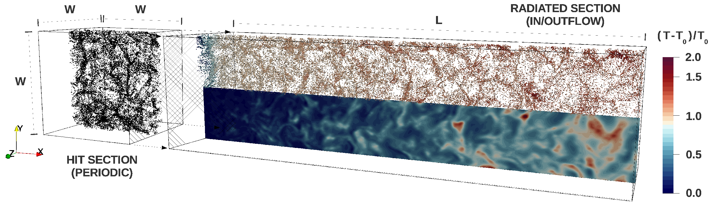

*Purpose*: Confidence and prediction intervals are useful for studying "pure sampling" of some distribution. However, we can combine CI and PI with regression analysis to equip our modeling efforts with powerful notions of uncertainty. In this challenge, you will use fluid simulation data in a regression analysis with uncertainty quantification (CI and PI) to support engineering design.

<!-- include-rubric -->

# Grading Rubric

<!-- -------------------------------------------------- -->

Unlike exercises, **challenges will be graded**. The following rubrics define how you will be graded, both on an individual and team basis.

## Individual

<!-- ------------------------- -->

| Category | Needs Improvement | Satisfactory |
|----|----|----|
| Effort | Some task **q**'s left unattempted | All task **q**'s attempted |
| Observed | Did not document observations, or observations incorrect | Documented correct observations based on analysis |
| Supported | Some observations not clearly supported by analysis | All observations clearly supported by analysis (table, graph, etc.) |
| Assessed | Observations include claims not supported by the data, or reflect a level of certainty not warranted by the data | Observations are appropriately qualified by the quality & relevance of the data and (in)conclusiveness of the support |
| Specified | Uses the phrase "more data are necessary" without clarification | Any statement that "more data are necessary" specifies which *specific* data are needed to answer what *specific* question |
| Code Styled | Violations of the [style guide](https://style.tidyverse.org/) hinder readability | Code sufficiently close to the [style guide](https://style.tidyverse.org/) |

## Submission

<!-- ------------------------- -->

Make sure to commit both the challenge report (`report.md` file) and supporting files (`report_files/` folder) when you are done! Then submit a link to Canvas. **Your Challenge submission is not complete without all files uploaded to GitHub.**

```{r setup}
library(tidyverse)
library(modelr)
library(broom)

## Helper function to compute uncertainty bounds
add_uncertainties <- function(data, model, prefix = "pred", ...) {
  df_fit <-
    stats::predict(model, data, ...) %>%
    as_tibble() %>%
    rename_with(~ str_c(prefix, "_", .))

  bind_cols(data, df_fit)
}
```

# Orientation: Exploring Simulation Results

*Background*: The data you will study in this exercise come from a computational fluid dynamics (CFD) [simulation campaign](https://www.sciencedirect.com/science/article/abs/pii/S0301932219308651?via%3Dihub) that studied the interaction of turbulent flow and radiative heat transfer to fluid-suspended particles[1]. These simulations were carried out to help study a novel design of [solar receiver](https://en.wikipedia.org/wiki/Concentrated_solar_power), though they are more aimed at fundamental physics than detailed device design. The following code chunk downloads and unpacks the data to your local `./data/` folder.

```{r data-download-unzip}
## NOTE: No need to edit this chunk
## Download PSAAP II data and unzip
url_zip <- "https://ndownloader.figshare.com/files/24111269"
filename_zip <- "./data/psaap.zip"
filename_psaap <- "./data/psaap.csv"

curl::curl_download(url_zip, destfile = filename_zip)
unzip(filename_zip, exdir = "./data")
df_psaap <- read_csv(filename_psaap)
```

 Figure 1. An example simulation, frozen at a specific point in time. An initial simulation is run (HIT SECTION) to generate a turbulent flow with particles, and that swirling flow is released into a rectangular domain (RADIATED SECTION) with bulk downstream flow (left to right). Concentrated solar radiation transmits through the optically transparent fluid, but deposits heat into the particles. The particles then convect heat into the fluid, which heats up the flow. The false-color image shows the fluid temperature: Notice that there are "hot spots" where hot particles have deposited heat into the fluid. The dataset `df_psaap` gives measurements of `T_norm = (T - T0) / T0` averaged across planes at various locations along the RADIATED SECTION.

### **q1** Perform your "initial checks" to get a sense of the data.

```{r q1-task}
## TODO: Perform your initial checks
df_psaap %>% glimpse()

df_psaap %>%
  summarize(
    n_rows = n(),
    n_sims = n_distinct(idx),
    n_locations = n_distinct(x)
  )
```

**Observations**:

- 140 rows and 22 columns. That is 35 simulations times 4 locations, so every run was measured at the same four places.
- x only takes the values 0.25, 0.5, 0.75 and 1. It is a location along the channel, not a continuous sweep.
- The Inputs stay constant within a simulation and change between simulations. The Outputs avg_q, avg_T, rms_T and T_norm change along x within a run.
- No missing values.

The important variables in this dataset are:

| Variable | Category | Meaning                           |
|----------|----------|-----------------------------------|
| `x`      | Spatial  | Channel location                  |
| `idx`    | Metadata | Simulation run                    |
| `L`      | Input    | Channel length                    |
| `W`      | Input    | Channel width                     |
| `U_0`    | Input    | Bulk velocity                     |
| `N_p`    | Input    | Number of particles               |
| `k_f`    | Input    | Turbulence level                  |
| `T_f`    | Input    | Fluid inlet temp                  |
| `rho_f`  | Input    | Fluid density                     |
| `mu_f`   | Input    | Fluid viscosity                   |
| `lam_f`  | Input    | Fluid conductivity                |
| `C_fp`   | Input    | Fluid isobaric heat capacity      |
| `rho_p`  | Input    | Particle density                  |
| `d_p`    | Input    | Particle diameter                 |
| `C_pv`   | Input    | Particle isochoric heat capacity  |
| `h`      | Input    | Convection coefficient            |
| `I_0`    | Input    | Radiation intensity               |
| `eps_p`  | Input    | Radiation absorption coefficient  |
| `avg_q`  | Output   | Plane-averaged heat flux          |
| `avg_T`  | Output   | Plane-averaged fluid temperature  |
| `rms_T`  | Output   | Plane-rms fluid temperature       |
| `T_norm` | Output   | Normalized fluid temperature rise |

The primary output of interest is `T_norm = (avg_T - T_f) / T_f`, the normalized (dimensionless) temperature rise of the fluid, due to heat transfer. These measurements are taken at locations `x` along a column of fluid, for different experimental settings (e.g. different dimensions `W, L`, different flow speeds `U_0`, etc.).

### **q2** Visualize `T_norm` against `x`. Note that there are multiple simulations at different values of the Input variables: Each simulation result is identified by a different value of `idx`.

```{r q2-task}
## TODO: Visualize the data in df_psaap with T_norm against x;
##       design your visual to handle the multiple simulations,
##       each identified by different values of idx
df_psaap %>%
  ggplot(aes(x, T_norm, group = idx)) +
  geom_line(alpha = 0.4) +
  labs(
    x = "Location along channel",
    y = "Normalized temperature rise"
  )
```

**Observations**:

- Every simulation rises with x. Fluid further downstream has been under the lamp longer.
- At x = 1 the runs spread from about 0.5 to 3, so the Inputs matter a lot.
- I used group = idx rather than coloring by it. 35 colors is an unreadable legend.

## Modeling

The following chunk will split the data into training and validation sets.

```{r data-split}
## NOTE: No need to edit this chunk
# Addl' Note: These data are already randomized by idx; no need
# to additionally shuffle the data!
df_train <- df_psaap %>% filter(idx %in% 1:20)
df_validate <- df_psaap %>% filter(idx %in% 21:36)
```

One of the key decisions we must make in modeling is choosing predictors (features) from our observations to include in the model. Ideally we should have some intuition for why these predictors are reasonable to include in the model; for instance, we saw above that location along the flow `x` tends to affect the temperature rise `T_norm`. This is because fluid downstream has been exposed to solar radiation for longer, and thus is likely to be at a higher temperature.

Reasoning about our variables---at least at a *high level*---can help us to avoid including *fallacious* predictors in our models. You'll explore this idea in the next task.

### **q3** The following code chunk fits a few different models. Compute a measure of model accuracy for each model on `df_validate`, and compare their performance.

```{r q3-task}
## NOTE: No need to edit these models
fit_baseline <- 
  df_train %>% 
  lm(formula = T_norm ~ x)

fit_cheat <- 
  df_train %>% 
  lm(formula = T_norm ~ avg_T)

fit_nonphysical <- 
  df_train %>% 
  lm(formula = T_norm ~ idx)

## TODO: Compute a measure of accuracy for each fit above;
##       compare their relative performance

tibble(
  model = c("baseline (x)", "cheat (avg_T)", "nonphysical (idx)"),
  mse = c(mse(fit_baseline, df_validate),
          mse(fit_cheat, df_validate),
          mse(fit_nonphysical, df_validate)),
  rsquare = c(rsquare(fit_baseline, df_validate),
              rsquare(fit_cheat, df_validate),
              rsquare(fit_nonphysical, df_validate))
)
```

**Observations**:

- Which model is *most accurate*? Which is *least accurate*?
  - fit_cheat is most accurate, mse 0.054 and rsquare 0.64. fit_nonphysical is worst at rsquare 0.002.
- What *Category* of variable is `avg_T`? Why is it such an effective predictor?
  - Output. T_norm is computed as (avg_T - T_f) / T_f, so I am predicting a quantity from the thing it is derived from.
- Would we have access to `avg_T` if we were trying to predict a *new* value of `T_norm`? Is `avg_T` a valid predictor?
  - No. avg_T is a simulation result, so if I had it I would already have T_norm. Not a valid predictor.
- What *Category* of variable is `idx`? Does it have any physical meaning?
  - Metadata. It is a run label with arbitrary numbering and no physical meaning.

### **q4** Interpret this model

Interpret the following model by answering the questions below.

*Note*. The `-` syntax in R formulas allows us to exclude columns from fitting. So `T_norm ~ . - x` would fit on all columns *except* `x`.

```{r q4-task}
## TODO: Inspect the regression coefficients for the following model
fit_q4 <- 
  df_train %>% 
  lm(formula = T_norm ~ . - idx - avg_q - avg_T - rms_T)
## TODO: Use some of the functions we learned in e-model01 through e-model03
fit_q4 %>% tidy() %>% arrange(p.value)

df_psaap %>% summarize(sd_x = sd(x), sd_T_f = sd(T_f))
```

**Observations**:

- Which columns are excluded in the model formula above? What categories do these belong to? Why are these important quantities to leave out of the model?
  - idx is Metadata. avg_q, avg_T and rms_T are Outputs. The Outputs come from the same simulation as T_norm, so using them repeats the q3 cheat. None of them would be available before running the simulation.
- Which inputs are *statistically significant*, according to the model?
  - At the 0.05 level: x, W, L, I_0, U_0, d_p and C_fp.
- What is the regression coefficient for `x`? What about the regression coefficient for `T_f`?
  - x is about 1.018. T_f is about -0.00038.
- What is the standard deviation of `x` in `df_psaap`? What about the standard deviation of `T_f`?
  - sd of x is about 0.28. sd of T_f is about 38.9.
- How do these standard deviations relate to the regression coefficients for `x` and `T_f`?
  - The coefficients are per unit, and the two variables have very different unit sizes. Multiplying coefficient by sd puts them on the same footing. x moves T_norm by about 0.29 over a typical swing, T_f by about -0.015. So x matters roughly 20 times more, which the raw coefficients do not show.
- Note that literally *all* of the inputs above have *some* effect on the output `T_norm`; so they are all "significant" in that sense. What does this tell us about the limitations of statistical significance for interpreting regression coefficients?
  - Significance says the coefficient is distinguishable from zero given the data I have. It says nothing about size. With more simulations the small effects would become significant too without becoming more important. To judge importance I need the coefficient scaled by how much the variable varies.

## Contrasting CI and PI

Let's revisit the ideas of confidence intervals (CI) and prediction intervals (PI). Let's fit a very simple model to these data, one which only considers the channel location and ignores all other inputs. We'll also use the helper function `add_uncertainties()` (defined in the `setup` chunk above) to add approximate CI and PI to the linear model.

```{r data-simple-model}
## NOTE: No need to edit this chunk
fit_simple <-
  df_train %>%
  lm(data = ., formula = T_norm ~ x)

df_intervals <-
  df_train %>%
  add_uncertainties(fit_simple, interval = "confidence", prefix = "ci") %>%
  add_uncertainties(fit_simple, interval = "prediction", prefix = "pi")
```

The following figure visualizes the regression CI and PI against the objects they are attempting to capture:

```{r data-simple-model-vis}
## NOTE: No need to edit this chunk
df_intervals %>%
  select(T_norm, x, matches("ci|pi")) %>%
  pivot_longer(
    names_to = c("method", ".value"),
    names_sep = "_",
    cols = matches("ci|pi")
  ) %>%

  ggplot(aes(x, fit)) +
  geom_errorbar(
    aes(ymin = lwr, ymax = upr, color = method),
    width = 0.05,
    size = 1
  ) +
  geom_smooth(
    data = df_psaap %>% mutate(method = "ci"),
    mapping = aes(x, T_norm),
    se = FALSE,
    linetype = 2,
    color = "black"
   ) +
  geom_point(
    data = df_validate %>% mutate(method = "pi"),
    mapping = aes(x, T_norm),
    size = 0.5
  ) +

  facet_grid(~method) +
  theme_minimal() +
  labs(
    x = "Channel Location (-)",
    y = "Normalized Temperature Rise (-)"
  )
```

Under the `ci` facet we have the regression confidence intervals and the mean trend (computed with all the data `df_psaap`). Under the `pi` facet we have the regression prediction intervals and the `df_validation` observations.

**Punchline**:

- Confidence intervals are meant to capture the *mean trend*
- Prediction intervals are meant to capture *new observations*

Both CI and PI are a quantification of the uncertainty in our model, but the two intervals designed to answer different questions.

Since CI and PI are a quantification of uncertainty, they should tend to *narrow* as our model becomes more confident in its predictions. Building a more accurate model will often lead to a reduction in uncertainty. We'll see this phenomenon in action with the following task:

### **q5** The following code will construct a predicted-vs-actual plot with your model from *q4* and add prediction intervals. Study the results and answer the questions below under *observations*.

```{r q5-task}
## TODO: Run this code and interpret the results
## NOTE: No need to edit this chunk
## NOTE: This chunk will use your model from q4; it will predict on the
##       validation data, add prediction intervals for every prediction,
##       and visualize the results on a predicted-vs-actual plot. It will
##       also compare against the simple `fit_simple` defined above.
bind_rows(
  df_psaap %>% 
    add_uncertainties(fit_simple, interval = "prediction", prefix = "pi") %>% 
    select(T_norm, pi_lwr, pi_fit, pi_upr) %>% 
    mutate(model = "x only"),
  df_psaap %>% 
    add_uncertainties(fit_q4, interval = "prediction", prefix = "pi") %>% 
    select(T_norm, pi_lwr, pi_fit, pi_upr) %>% 
    mutate(model = "q4"),
) %>% 
  
  ggplot(aes(T_norm, pi_fit)) +
  geom_abline(slope = 1, intercept = 0, color = "grey80", size = 2) +
  geom_errorbar(
    aes(ymin = pi_lwr, ymax = pi_upr),
    width = 0
  ) +
  geom_point() +
  
  facet_grid(~ model, labeller = label_both) +
  theme_minimal() +
  labs(
    title = "Predicted vs Actual",
    x = "Actual T_norm",
    y = "Predicted T_norm"
  )
```

**Observations**:

- Which model tends to be more accurate? How can you tell from this predicted-vs-actual plot?
  - The q4 model. Its points sit much closer to the diagonal. The x-only points form four vertical stacks because x has only four values, so that model can only predict four numbers. On the validation data q4 gets rsquare 0.79 against 0.47.
- Which model tends to be *more confident* in its predictions? Put differently, which model has *narrower prediction intervals*?
  - q4. Its error bars are much shorter. Including the Inputs explains variation that the x-only model leaves in the error term.
- How many predictors does the `fit_simple` model need in order to make a prediction? What about your model `fit_q4`?
  - fit_simple needs 1. fit_q4 needs 17. That is the tradeoff. q4 is more accurate and more confident, but you need 17 quantities before you can use it.

Based on these results, you might be tempted to always throw every reasonable variable into the model. For some cases, that might be the best choice. However, some variables might be *outside our control*; for example, variables involving human behavior cannot be fully under our control. Other variables may be *too difficult to measure*; for example, it is *in theory* possible to predict the strength of a component by having detailed knowledge of its microstructure. However, it is *patently infeasible* to do a detailed study of *every single component* that gets used in an airplane.

In both cases---human behavior and variable material properties---we would be better off treating those quantities as random variables. There are at least two ways we could treat these factors: 1. Explicitly model some inputs as random variables and construct a model that *propagates* that uncertainty from inputs to outputs, or 2. Implicitly model the uncontrolled the uncontrolled variables by not including them as predictors in the model, and instead relying on the error term $\epsilon$ to represent these unaccounted factors. You will pursue strategy 2. in the following Case Study.

# Case Study: Predicting Performance Ranges

### **q6** You are consulting with a team that is designing a prototype heat transfer device. They are asking you to help determine a *dependable range of values* for `T_norm` they can design around for this *single prototype*. The realized value of `T_norm` must not be too high as it may damage the downstream equipment, but it must also be high enough to extract an acceptable amount of heat.

In order to maximize the conditions under which this device can operate successfully, the design team has chosen to fix the variables listed in the table below, and consider the other variables to fluctuate according to the values observed in `df_psaap`.

| Variable | Value    |
|----------|----------|
| `x`      | 1.0      |
| `L`      | 0.2      |
| `W`      | 0.04     |
| `U_0`    | 1.0      |
| (Other)  | (Varies) |

Your task is to use a regression analysis to deliver to the design team a *dependable range* of values for `T_norm`, given their proposed design, and at a fairly high level `0.8`. Perform your analysis below (use the helper function `add_uncertainties()` with the `level` argument!), and answer the questions below.

*Hint*: This problem will require you to *build a model* by choosing the appropriate variables to include in the analysis. Think about *which variables the design team can control*, and *which variables they have chosen to allow to vary*. You will also need to choose between computing a CI or PI for the design prediction.

```{r q6-task}
# NOTE: No need to change df_design; this is the target the client
#       is considering
df_design <- tibble(x = 1, L = 0.2, W = 0.04, U_0 = 1.0)
# NOTE: This is the level the "probability" level customer wants
pr_level <- 0.8

## TODO: Fit a model, assess the uncertainty in your prediction, 
#        use the validation data to check your uncertainty estimates, and 
#        make a recommendation on a *dependable range* of values for T_norm
#        at the point `df_design`
## Fit on only the variables the design team controls. Everything else is
## left out on purpose, so its variation lands in the error term.
fit_q6 <-
  df_train %>%
  lm(formula = T_norm ~ x + L + W + U_0)

fit_q6 %>% tidy()

## Check the model on held-out data
tibble(
  mse = mse(fit_q6, df_validate),
  rsquare = rsquare(fit_q6, df_validate)
)

## Does an 80% prediction interval actually cover 80% of held-out points?
df_validate %>%
  add_uncertainties(fit_q6, interval = "prediction", level = pr_level, prefix = "pi") %>%
  summarize(
    n = n(),
    coverage = mean(T_norm >= pi_lwr & T_norm <= pi_upr)
  )

## The recommendation
df_design %>%
  add_uncertainties(fit_q6, interval = "prediction", level = pr_level, prefix = "pi")

## Confidence interval at the same point, for contrast
df_design %>%
  add_uncertainties(fit_q6, interval = "confidence", level = pr_level, prefix = "ci")

```

**Recommendation**:

- How much do you trust your model? Why?
  - Reasonably, for this purpose. On the validation data it gets rsquare 0.68 using only the four variables the team controls. All four coefficients are significant.
  - It is deliberately worse than the q4 model, which got 0.79. I left the other inputs out because the team is not fixing them, so their variation belongs in the error term.
  - The design point sits inside the range of the training data on all four variables, so this is interpolation rather than extrapolation.
- What kind of interval---confidence or prediction---would you use for this task, and why?
  - Prediction interval. They are building one prototype and need a range that single device will land in. A confidence interval covers the average T_norm across many devices built to this spec, which is a different question.
  - The CI at the design point is 1.69 to 2.07. The PI is 1.46 to 2.30, more than twice as wide. Quoting the CI would understate the risk.
- What fraction of validation cases lie within the intervals you predict? (NB. Make sure to calculate your intervals *based on the validation data*; don't just use one single interval!) How does this compare with `pr_level`?
  - 93.3% of the 60 validation points fall inside their 80% intervals. That is above the 80% target, so the intervals are conservative.
  - That is the safe direction to be wrong in here, but the true range is probably tighter than what I am quoting.
- What interval for `T_norm` would you recommend the design team to plan around?
  - 1.46 to 2.30, central estimate 1.88. The downstream equipment should tolerate the top of that range, and heat extraction should still be acceptable at the bottom.
- Are there any other recommendations you would provide?
  - The interval is wide because most inputs are free to vary. Controlling more of them will tighten it. W has the largest coefficient of the four they already fix, so geometry is worth holding tightly.
  - Only 20 simulations went into the fit, all at the same four x locations. I would not use this model outside the range of conditions in the training set.
  - The 93% coverage says the intervals are wider than they need to be. More validation runs would let me check that and tighten the recommendation.

*Bonus*: One way you could take this analysis further is to recommend which other variables the design team should tightly control. You could do this by fixing values in `df_design` and adding them to the model. An exercise you could carry out would be to systematically test the variables to see which ones the design team should more tightly control.

# References

- [1] Jofre, del Rosario, and Iaccarino "Data-driven dimensional analysis of heat transfer in irradiated particle-laden turbulent flow" (2020) *International Journal of Multiphase Flow*, <https://doi.org/10.1016/j.ijmultiphaseflow.2019.103198>
